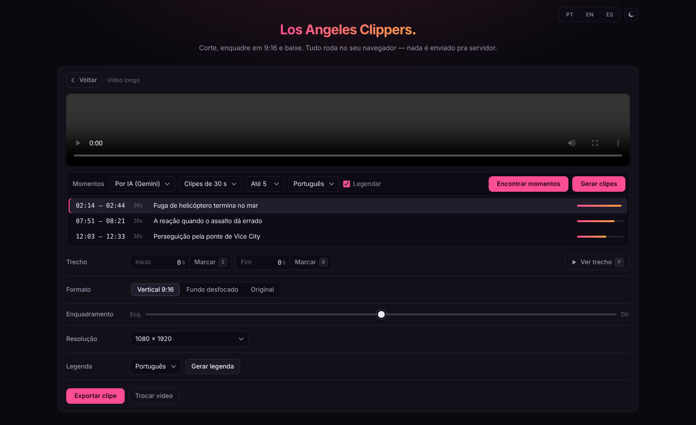
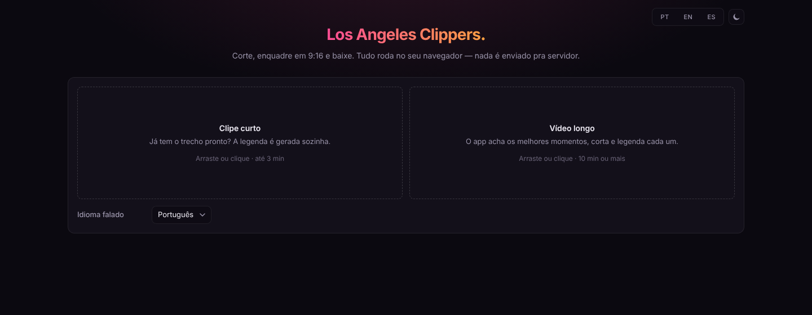
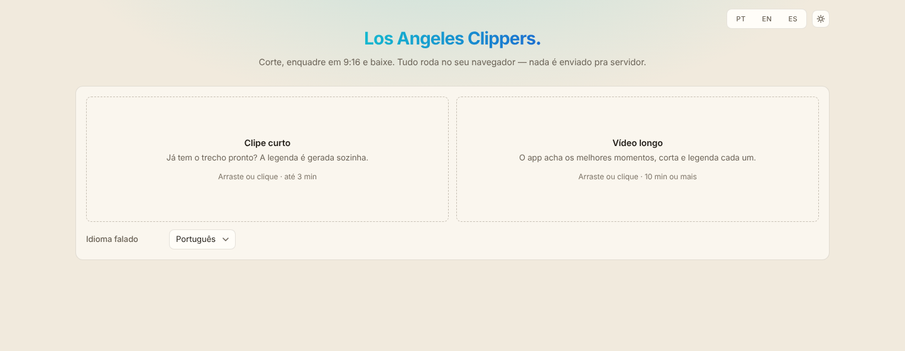
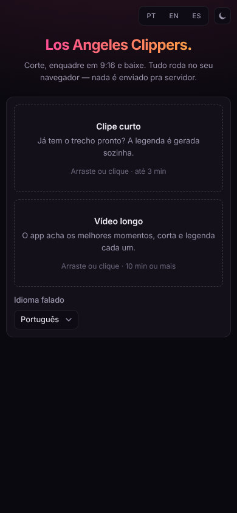

# Los Angeles Clippers ✂️

[🇧🇷 Português](README.md) · 🇺🇸 English

**A vertical clip editor (TikTok, Shorts, Reels) that runs entirely in the browser.**
It trims, reframes to 9:16, captions automatically, and, for long videos, finds the best moments on its own.
The video never leaves the user's computer.

🔗 **Live demo:** [clippersapp.vercel.app](https://clippersapp.vercel.app/)



---

## Why I built it

With GTA 6 coming out, I wanted to cut gameplay and streams into short clips without paying for a third-party tool or uploading multi-gigabyte files to a server.
The challenge I set for myself: do **everything in the browser**, meaning video editing, speech recognition and burned-in captions, with no backend.

## What it does

| | |
|---|---|
| **Short clip** | Opens the video and immediately generates captions in the spoken language (Portuguese, English or Spanish). |
| **Long video** | Finds the strongest moments, either with AI (Gemini listens to the audio and suggests a title) or by audio loudness (offline). Then it cuts and captions them all in a queue. |
| **3 output formats** | 9:16 vertical with adjustable framing, vertical over a blurred background, or the original aspect ratio without re-encoding. |
| **Editable captions** | Word-by-word highlight, with text and timing you can fix before exporting. |
| **Interface** | PT / EN / ES, dark and light themes, responsive layout, keyboard shortcuts (I, O, P). |

<p>
  
  
</p>
<p align="center"></p>

## Stack

- **Vanilla JavaScript (ES Modules), HTML and CSS**, no framework, so I could understand every piece
- **[Vite](https://vitejs.dev)** for the dev server and build
- **[FFmpeg.wasm](https://github.com/ffmpegwasm/ffmpeg.wasm)**: FFmpeg compiled to WebAssembly (trim, crop, blur, burned-in ASS subtitles)
- **[Transformers.js](https://huggingface.co/docs/transformers.js) + Whisper small**: speech recognition with word-level timestamps, running in a Web Worker
- **[Gemini API](https://ai.google.dev)**: content-aware moment picking, with structured JSON output (`responseSchema`)
- **Web Audio API**: loudness analysis for the offline mode
- **Vercel** for continuous deployment on every push

## Technical challenges I solved

- **1 GB+ videos in the browser.** Copying the whole file into FFmpeg's memory froze the tab. I switched to mounting the file with `WORKERFS`, which reads straight from disk, and kept the in-memory copy only as a fallback.
- **Inaccurate captions.** The quantized Whisper *base* model (`q8`) made mistakes even on clean audio. I switched to *small* in `fp32`. It is slower, but much more accurate, and I chose quality over speed.
- **Unreliable AI API.** Gemini sometimes returns 503 (high demand). I added dynamic discovery of the available Flash models, a retry on the same model for 503, and a fallback to the next model for 403/404/429. The response is also validated: timestamps outside the video and overlapping clips are discarded.
- **A moment detector without AI.** It measures loudness (RMS in dB) every 0.25 s, scores peaks above the median, picks non-overlapping windows, and snaps start and end to the nearest silence so a clip never starts mid-word.
- **Captions identical in preview and export.** I generate an ASS file with the Inter font embedded in FFmpeg, so the burned-in text matches what the editor shows.
- **No theme flash on load.** An inline script in `<head>` applies the saved theme before the first paint. All colors are CSS variables, so a theme is just a block of tokens.
- **i18n without a library.** `data-i18n` attributes plus one dictionary per language, with an automatic check for keys missing between the three languages.

## Architecture

```
index.html                 markup for the 3 steps (upload → editor → clips)
src/
├── main.js                state, events and FFmpeg command building
├── transcricao.worker.js  Whisper running off the main thread
├── legenda.js             groups words into caption blocks and writes the .ass file
├── momentos.js            loudness-based moment detector
├── ia.js                  Gemini integration (prompt, schema, retries, validation)
├── i18n.js                strings in pt, en and es
└── style.css              theme tokens + components
```

The code is written in Portuguese (variable and file names), my native language.

## Running locally

Requires [Node.js](https://nodejs.org) 18+.

```bash
npm install
npm run dev
```

**Gemini key (optional):** to use the AI mode, create a free key at [Google AI Studio](https://aistudio.google.com/apikey) and paste it into the app.
It is stored only in your browser's `localStorage`, never in the code. In this mode, the video's audio is sent to Google for analysis.

## Known limitations

- On first use, FFmpeg (~30 MB) and the Whisper model are downloaded. After that, they are cached.
- FFmpeg.wasm runs on a single thread, so exporting is slower than with a native app.
- The loudness detector catches screams and explosions but does not understand speech (that is what the AI mode is for).
- The "Original" format cuts at the nearest keyframe and has no captions.

## Next steps

- [ ] Caption styles (color, position, size)
- [ ] Split layout (gameplay on top, facecam below)
- [ ] Input from a link, via a local server running yt-dlp
- [ ] Serverless backend to hide the key and open the AI mode to the public

---

Made by **Pedro Cardinali** · [GitHub](https://github.com/cardinalipedro)
