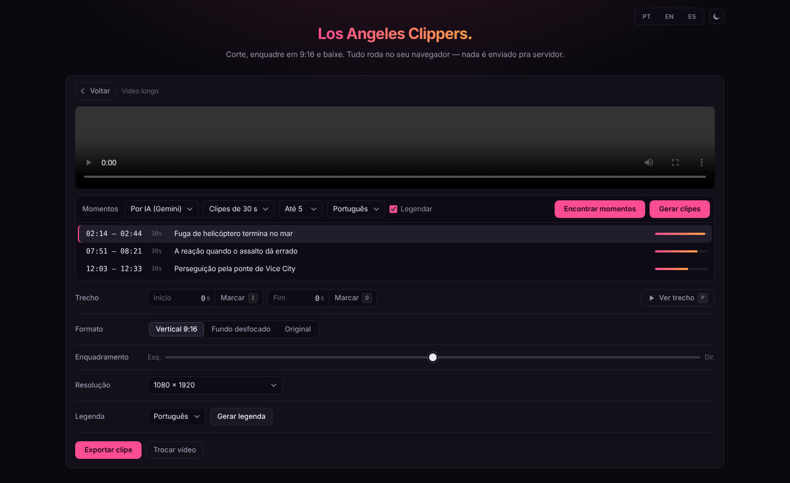
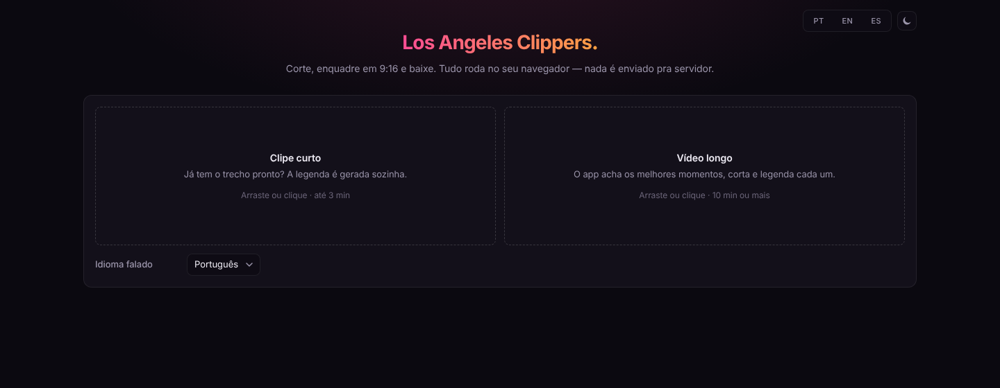
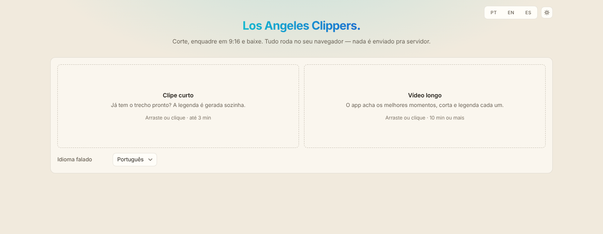
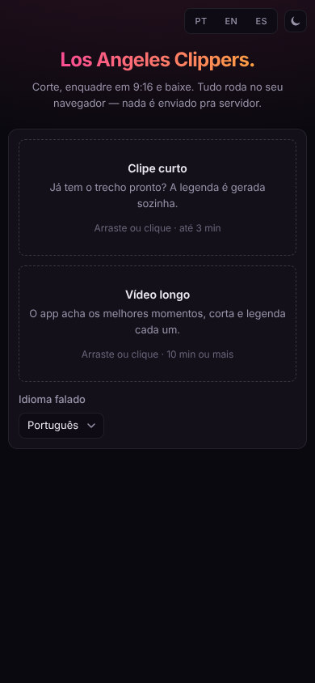

# Los Angeles Clippers ✂️

🇧🇷 Português · [🇺🇸 English](README.en.md)

**Editor de clipes verticais (TikTok, Shorts, Reels) que roda inteiro no navegador.**
Corta, enquadra em 9:16, legenda automaticamente e, em vídeos longos, encontra os melhores momentos sozinho.
O vídeo nunca sai do computador do usuário.

🔗 **Demo:** [clippersapp.vercel.app](https://clippersapp.vercel.app/)



---

## Por que eu fiz

Com o lançamento do GTA 6, quis cortar gameplay e lives em clipes curtos sem pagar ferramenta de terceiros nem subir vídeos de gigabytes para um servidor.
O desafio que me propus: fazer **tudo no navegador**, ou seja, edição de vídeo, reconhecimento de fala e legenda queimada, sem backend.

## O que ele faz

| | |
|---|---|
| **Clipe curto** | Abre o vídeo e já gera a legenda automática no idioma falado (português, inglês ou espanhol). |
| **Vídeo longo** | Encontra os momentos mais fortes, por IA (Gemini, que ouve o áudio e sugere título) ou pelo volume do som (offline). Depois corta e legenda tudo em fila. |
| **3 formatos** | Vertical 9:16 com enquadramento ajustável, vertical com fundo desfocado, ou corte original sem recodificar. |
| **Legenda editável** | Destaque palavra por palavra, com texto e tempos que dá para corrigir antes de exportar. |
| **Interface** | PT / EN / ES, tema escuro e claro, layout responsivo, atalhos de teclado (I, O, P). |

<p>
  
  
</p>
<p align="center"></p>

## Stack

- **JavaScript (ES Modules), HTML e CSS puros**, sem framework, para entender cada peça
- **[Vite](https://vitejs.dev)** para desenvolvimento e build
- **[FFmpeg.wasm](https://github.com/ffmpegwasm/ffmpeg.wasm)**: FFmpeg compilado para WebAssembly (corte, crop, blur, legenda ASS queimada)
- **[Transformers.js](https://huggingface.co/docs/transformers.js) + Whisper small**: reconhecimento de fala com timestamp por palavra, rodando num Web Worker
- **[Gemini API](https://ai.google.dev)**: escolha de momentos pelo conteúdo, com resposta em JSON estruturado (`responseSchema`)
- **Web Audio API**: análise de volume para o modo offline
- **Vercel** para deploy contínuo a cada push

## Desafios técnicos que resolvi

- **Vídeos de mais de 1 GB no navegador.** Copiar o arquivo inteiro para a memória do FFmpeg travava a aba. Passei a montar o arquivo com `WORKERFS`, que lê direto do disco, e deixei a cópia em memória só como plano B.
- **Legenda errando muito.** O Whisper *base* quantizado (`q8`) errava até em áudio limpo. Troquei para o *small* em `fp32`. Fica mais lento, mas a precisão melhorou bastante, e preferi qualidade à velocidade.
- **IA instável.** A API do Gemini às vezes responde 503 (alta demanda). Fiz a descoberta dinâmica dos modelos Flash disponíveis, com nova tentativa no mesmo modelo para 503 e troca de modelo para 403/404/429. Além disso, a resposta é validada: tempos fora do vídeo e clipes sobrepostos são descartados.
- **Detector de momentos sem IA.** Ele mede o volume (RMS em dB) a cada 0,25 s, pontua os picos acima da mediana, escolhe janelas sem sobreposição e ajusta início e fim para o silêncio mais próximo, para o clipe não começar no meio de uma palavra.
- **Legenda igual na prévia e no vídeo final.** Gero um arquivo ASS com a fonte Inter embutida no FFmpeg, para o texto queimado ficar idêntico ao que aparece no editor.
- **Tema sem "piscar".** Um script inline no `<head>` aplica o tema salvo antes da primeira pintura. As cores são todas variáveis CSS, então um tema é só um bloco de tokens.
- **i18n sem biblioteca.** Uso atributos `data-i18n` e um dicionário por idioma, com checagem automática de chaves faltando entre os três idiomas.

## Arquitetura

```
index.html                 estrutura das 3 etapas (upload → editor → clipes)
src/
├── main.js                estado, eventos e montagem dos comandos do FFmpeg
├── transcricao.worker.js  Whisper rodando fora da thread principal
├── legenda.js             agrupa palavras em blocos e gera o arquivo .ass
├── momentos.js            detector de momentos pelo volume do áudio
├── ia.js                  integração com o Gemini (prompt, schema, retry, validação)
├── i18n.js                textos em pt, en e es
└── style.css              tokens dos temas + componentes
```

## Rodando localmente

Pré-requisito: [Node.js](https://nodejs.org) 18+.

```bash
npm install
npm run dev
```

**Chave do Gemini (opcional):** para usar o modo por IA, crie uma chave grátis no [Google AI Studio](https://aistudio.google.com/apikey) e cole no app.
Ela fica só no `localStorage` do seu navegador, nunca no código. Nesse modo, o áudio do vídeo é enviado ao Google para análise.

## Limitações conhecidas

- Na primeira vez, o FFmpeg (~30 MB) e o modelo do Whisper são baixados. Depois ficam em cache.
- O FFmpeg.wasm usa uma thread só, então exportar é mais lento que num programa nativo.
- O detector pelo som acha gritos e explosões, mas não entende o que foi dito (para isso existe o modo IA).
- O formato "Original" corta no keyframe mais próximo e sai sem legenda.

## Próximos passos

- [ ] Estilos de legenda (cor, posição, tamanho)
- [ ] Layout dividido (gameplay em cima, reação embaixo)
- [ ] Entrada por link, com um servidor local usando yt-dlp
- [ ] Backend serverless para esconder a chave e abrir o modo IA ao público

---

Feito por **Pedro Cardinali** · [GitHub](https://github.com/cardinalipedro)
